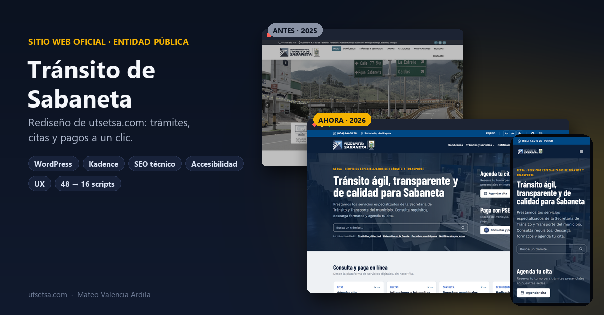
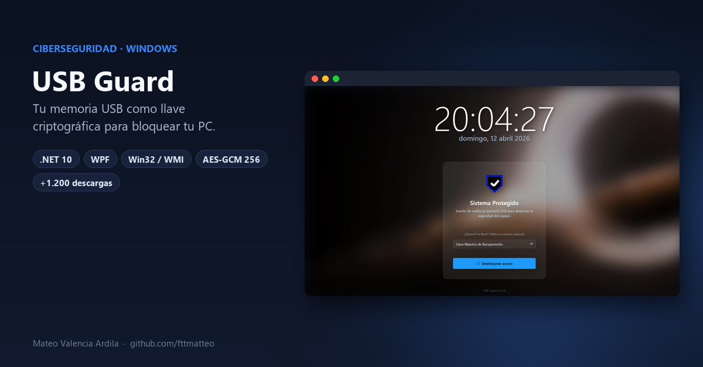
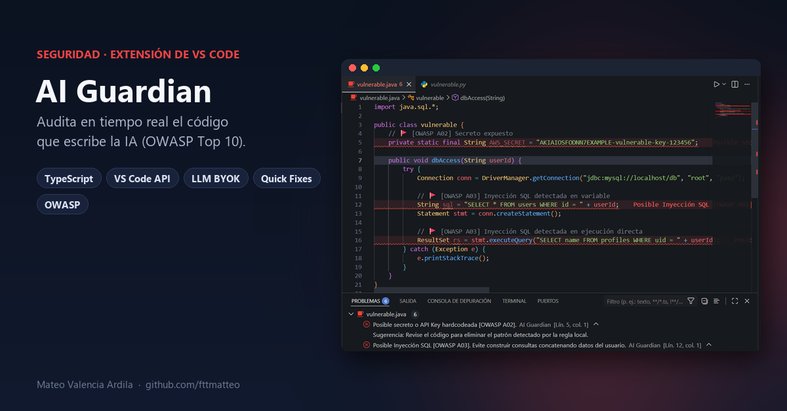
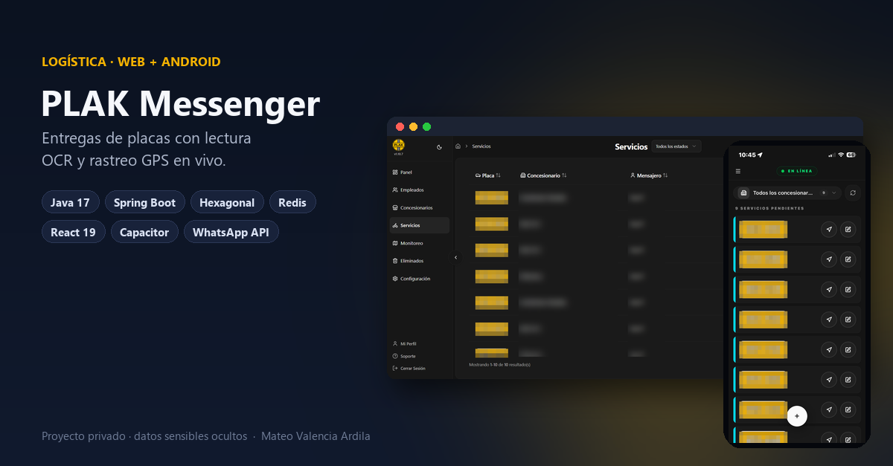
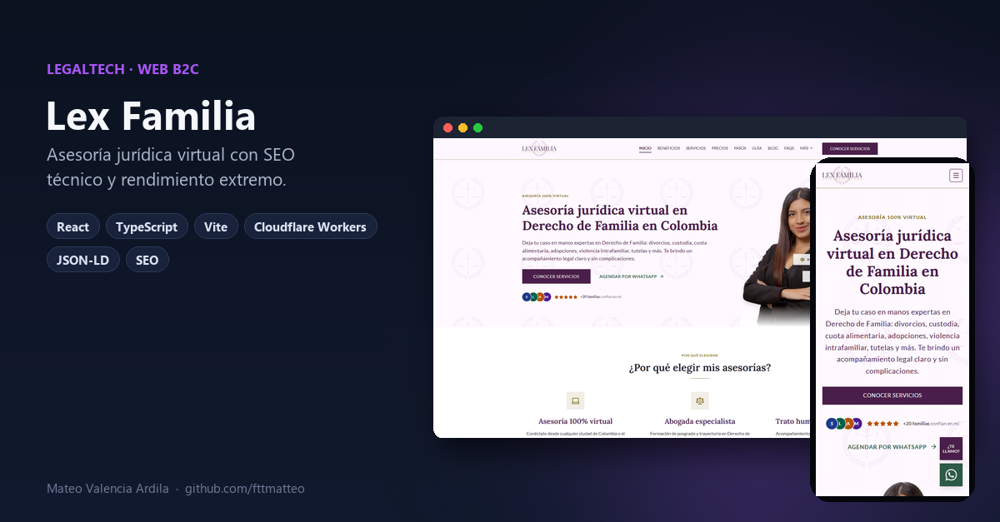
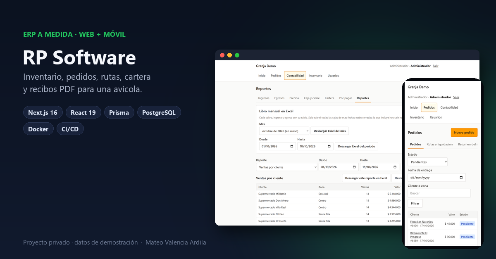

 

Construyo software completo, del backend a la app móvil, pensando en la seguridad desde la primera línea. 
Auxiliar de Sistemas en el Tránsito de Sabaneta · Estudiante de Ingeniería de Software y Datos (IU Digital de Antioquia) · Medellín, Colombia

## Proyecto destacado

<table>
  <tbody>
    <tr>
      <td width="60%" valign="middle">
        
      </td>
      <td width="40%" valign="middle">
        
<b><big>Sitio web oficial del Tránsito de Sabaneta</big></b>

        
Rediseñé <a href="https://utsetsa.com/">utsetsa.com</a> en mi primer mes como Auxiliar de Sistemas: trámites, citas y pagos PSE a un clic, buscador de trámites y controles de accesibilidad.

        
SEO técnico con datos estructurados y una portada más liviana: de 48 a 16 scripts y de 10 plugins a 1.

        

          
          
        

      </td>
    </tr>
  </tbody>
</table>

## Proyectos

<table>
  <tbody>
    <tr>
      <!-- USB GUARD -->
      <td width="50%" valign="top">
        
        

          
          
        

        
Convierte una memoria USB en una llave criptográfica: si la desconectas, Windows se bloquea al instante. Valida el serial del hardware (Win32 API, WMI), protege las llaves con AES-GCM 256 y frena la fuerza bruta con espera exponencial.

        
🏆 Insignia de SourceForge por su número de descargas.

      </td>
      <!-- AI GUARDIAN -->
      <td width="50%" valign="top">
        
        

          
          
        

        
Extensión de VS Code que audita en tiempo real el código generado con IA contra el OWASP Top 10 y propone la corrección con <kbd>Ctrl</kbd> + <kbd>.</kbd>. Reglas locales rápidas + LLM cuando hace falta, con tus propias llaves (Gemini, OpenAI o Claude).

      </td>
    </tr>
    <tr>
      <!-- PLAK MESSENGER -->
      <td width="50%" valign="top">
        
        

          
          
        

        
Entregas de placas vehiculares del tránsito a concesionarios: foto de la placa → OCR, GPS en vivo con WebSockets y Redis, avisos por WhatsApp y app Android que funciona sin señal. Backend Java + Spring Boot con arquitectura hexagonal verificada con ArchUnit.

      </td>
      <!-- LEX FAMILIA -->
      <td width="50%" valign="top">
        
        

          
          
        

        
Plataforma LegalTech de asesoría jurídica en Derecho de Familia. SEO técnico (prerenderizado, JSON-LD), accesibilidad y rendimiento como requisito. React + TypeScript + Vite sobre Cloudflare Workers.

      </td>
    </tr>
    <tr>
      <!-- RP SOFTWARE -->
      <td width="50%" valign="top">
        
        

          
        

        
ERP web y móvil para una empresa avícola: inventario por movimientos, pedidos, rutas de entrega, recibos PDF, cartera y caja, con roles verificados en el servidor. Next.js + Prisma + PostgreSQL, Docker y CI/CD.

      </td>
      <td width="50%" valign="middle" align="center">
        
<b>¿Quieres ver más?</b>

        
Los proyectos privados no tienen el código abierto, pero con gusto te cuento cómo están hechos.

        
      </td>
    </tr>
  </tbody>
</table>

## Tecnologías

  <table>
    <tbody>
      <tr>
        <td align="center" width="25%" valign="top">
          <b>Backend y datos</b>  
           
           
           
           
           
           
          
        </td>
        <td align="center" width="25%" valign="top">
          <b>Frontend y móvil</b>  
           
           
           
           
           
           
          
        </td>
        <td align="center" width="25%" valign="top">
          <b>Ciberseguridad y Windows</b>  
           
           
           
           
          
        </td>
        <td align="center" width="25%" valign="top">
          <b>DevOps y calidad</b>  
           
           
           
           
           
           
          
        </td>
      </tr>
    </tbody>
  </table>

## Actividad

  
  

   
  <picture>
    <source media="(prefers-color-scheme: dark)" srcset="https://raw.githubusercontent.com/fttmatteo/fttmatteo/output/snake.svg">
    <source media="(prefers-color-scheme: light)" srcset="https://raw.githubusercontent.com/fttmatteo/fttmatteo/output/snake.svg">
    
  </picture>

 

  

